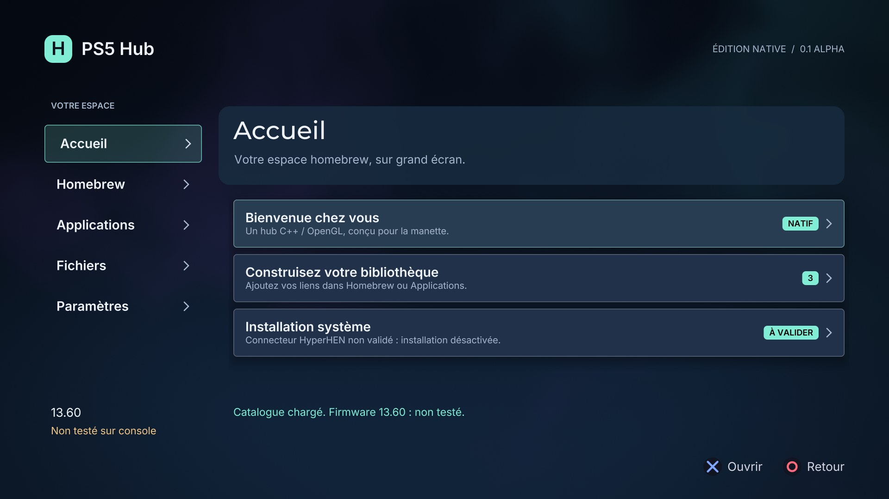

# PS5 Hub

Application homebrew **native C++20 / OpenGL** pour PS5, en français. Première alpha expérimentale : elle constitue une base testable à faire évoluer après un premier retour matériel.

**Firmware 13.60 : non validé. Aucun lancement de PS5 Hub sur une console n’a encore été effectué.** Les versions HyperHEN et ShadowMountPlus de la configuration cible restent inconnues.



Capture du rendu natif sur PC ; aucune capture PS5 n’est présentée comme preuve matérielle.

## Fonctionnalités de cette alpha

- Interface sombre, cinq rubriques : Accueil, Homebrew, Applications, Fichiers, Paramètres.
- Navigation au pavé directionnel / stick, actions DualSense et clavier à l’écran du kit.
- Icône originale et dossier de titre natif `PPSA99841` pour les chargeurs compatibles avec les dossiers homebrew.
- Catalogue de projets libres, avec une archive officielle Homebrew UI Lab et son empreinte de release.
- Ajout de liens personnels vers des archives ou des PKG depuis la manette ; sauvegarde dans le stockage du titre.
- Téléchargement après confirmation, HTTPS vérifié, contrôle SHA-256 obligatoire, annulation et fichiers temporaires.
- Liste des téléchargements, préférences persistantes, journal des erreurs et recherche de version PS5 Hub.
- Scripts de compilation WSL, préparation du ZIP, transfert FTP 2121 vérifié et workflow GitHub Actions.

**Fonctions restant à développer :** installation système des PKG ou archives depuis l’application, lancement des autres titres, explorateur global du disque et gestion d’une grande bibliothèque. Le hub indique ces limites dans l’interface ; il ne simule aucune installation réussie. Les téléchargements de cette alpha utilisent le stockage privé, dont la capacité doit être mesurée sur console.

## Compiler et installer

Voir [compilation Windows 11 / WSL](docs/BUILD_WINDOWS_FR.md), [installation USB / FTP](docs/INSTALLATION_FR.md) et [protocole de validation 13.60](docs/COMPATIBILITE_13_60.md).

Dans Ubuntu 24.04 avec les dépendances du guide :

```bash
bash tools/hub-build.sh
```

Le dossier de test est `dist/PPSA99841/`. Le ZIP expérimental et son SHA-256 sont créés dans `dist/`. Un build réussi confirme la compilation et le format ; il ne confirme pas la compatibilité matérielle.

[Résultats des tests locaux](docs/VALIDATION_PC.md) : 425 tests C++ réussis, 4 tests d’outils FTP simulés, rendus OpenGL vérifiés et téléchargement HTTPS réel avec contrôle d’empreinte. Le binaire expérimental est distribué dans les [préversions GitHub](https://github.com/tomoff1/ps5-hub/releases).

## Sources et architecture

`src/concepts/hub.cpp` contient l’écran principal. `src/hub/` contient le modèle du catalogue et le travailleur réseau/disque. Le rendu, les composants, les entrées et le runtime viennent du kit natif amont. Les exemples de la galerie restent dans les sources comme références et tests du kit ; seul PS5 Hub est enregistré et affiché.

Le catalogue personnel et les journaux restent sur la console. Le dépôt public ne contient ni adresse de console, ni identifiants FTP, ni liens personnels, ni jeu commercial.

## Bases open source

- [ps5-homebrew-ui](https://github.com/blackbearreloaded/ps5-homebrew-ui), commit `bbe19054ee2e7ec069254775273aeb8846c4bd3e` : rendu, composants, contrôleur, outils et runtime intégrés.
- [ps5-native-app-boilerplate](https://github.com/blackbearreloaded/ps5-native-app-boilerplate), commit `44ae1dab529654eac795d2a7c4f5a0425102b8d7` : référence de packaging et adaptateur libcurl console.
- SDK public ps5-payload-dev, ps5-opengl et PacBrew : dépendances récupérées par les scripts épinglés du kit.

Licence **GPL-3.0-or-later**, avec les licences tierces dans [THIRD_PARTY_NOTICES.md](THIRD_PARTY_NOTICES.md). Distribuez les sources correspondantes avec les versions binaires et conservez les notices. PS5 Hub est un projet indépendant, sans affiliation avec Sony ou Overdrive ; ses visuels sont originaux.
